<div align="center">


# AI Job Analyzer

**A self-hosted, AI-powered job-search workspace.**
Analyze any job against your real experience, generate a tailored ATS-friendly resume and cover letter for *every* application, and track it all from first posting to offer.

[](LICENSE)
[](https://www.djangoproject.com/)
[](https://react.dev/)
[](#privacy--security)

[Watch the demo](#demo) · [Features](#features) · [Screenshots](#screenshots) · [Quick start](#quick-start) · [Architecture](#architecture)

</div>

---

## Demo

<a href="docs/demo/ai-job-analyzer-full-v2-16x9-github.mp4">
  
</a>

> Click the animated preview to watch the full walkthrough: store your career once, analyze a job, generate a tailored resume and cover letter, and track the application.


---

## Why this project exists

Most people keep one or two versions of their resume and send them everywhere. But a frontend role that cares about map visualization, a backend role focused on APIs, and a full-stack role are three different conversations.

AI Job Analyzer lets you keep **one private source of truth** (your *Memory*) and then generate **a resume and a cover letter tailored to each specific job**, using only facts you have actually stored. Instead of "one resume for every company", you get "the right resume for this company", in minutes, in an ATS-friendly layout.

Around that core sits everything else a job hunt needs: job analysis with evidence, company research, a kanban board, and an AI assistant that knows your background.

---

## Features

### Tailored resumes and cover letters (the core)
- **Per-job resume builder.** Generates resume versions for a specific posting from your master profile. Give it a short instruction such as *"Frontend role, emphasize React and map-based data visualization, one page"* and regenerate.
- **No invented experience.** Unsupported details stay as visible placeholders. The cover-letter builder states that the AI cannot add facts outside your Memory or the company profile.
- **Quality review.** AI recommendations are tracked as *Needs work* and *Fixed* items per version, with a resume-quality score.
- **Version history and PDF export** for both resumes and cover letters, with selectable cover-letter templates and an editable preview.

### AI job analysis
- Extracts requirements, seniority, location policy and possible deal-breakers from the posting.
- Compares them against your resume and Memory and produces a structured dashboard: match assessment, skills coverage (matched / partial / missing), strengths, gaps with mitigations, confidence, and an explanation of how scores were computed.
- Tabs for **Overview, Skills, Company and Action plan** (resume improvements and interview preparation).
- Match scores are decision support, not a hiring probability.

### Personal Memory
- A hierarchical tree of folders and records (work experience, skills, education, projects, links…) that the AI can reference across every workflow.
- **AI-assisted arrangement** (newest information wins on conflicts), bulk move and delete, search.
- **Export / import:** `.mem` for a full round-trippable backup and `.tex` for a human-readable copy.
- Destructive actions such as *Clean memory* require confirmation.

### Job tracker and companies
- **Table and Kanban views:** Watchlist → Applied → Interview → Offer / Not selected, with drag-and-drop ordering, search, sorting and per-job match scores.
- **Companies workspace:** employer records with logos, industry, location, facts (with source and confidence) and employee contacts, kept separate from individual applications.

### Chat assistant
- ChatGPT-style conversations with rich Markdown (tables, checklists, syntax-highlighted code with copy buttons), file/URL/browser context, and persistent history.
- Content direction adapts automatically, so mixed-language notes (for example Persian text) display correctly.

### Bring your own AI
- OpenAI, Anthropic, Google Gemini, OpenRouter, Groq, Mistral, DeepSeek, xAI, local **Ollama** (no key needed), or any custom OpenAI-compatible endpoint.
- Model list is fetched live from the provider, with manual entry as a fallback.

### Personalization
- Light, dark and system themes. English interface with optional **Jalali calendar**, date/time format and timezone settings.

---

## Screenshots

### Analyze a job against your real experience

<picture>
  <source media="(prefers-color-scheme: dark)" srcset="docs/screenshots/dark-job-analysis-tab1.webp">
  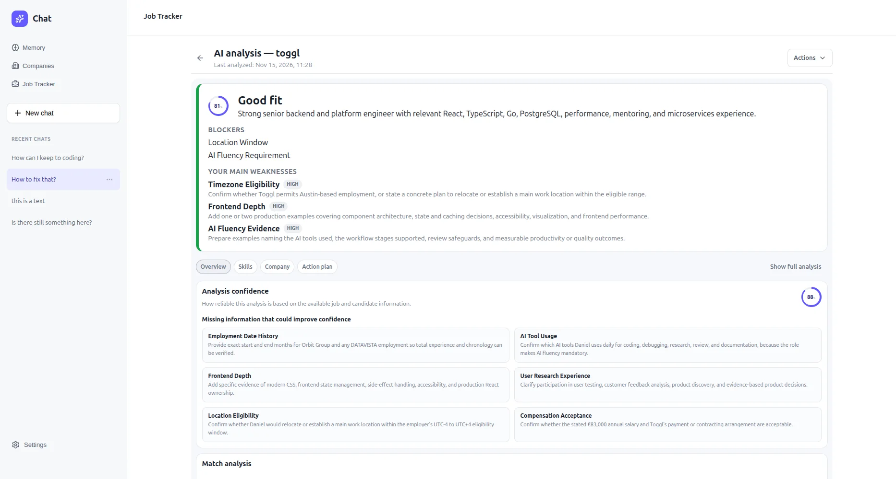
</picture>

<table>
  <tr>
    <td width="50%">
      <picture>
        <source media="(prefers-color-scheme: dark)" srcset="docs/screenshots/dark-job-analysis-tab2.webp">
        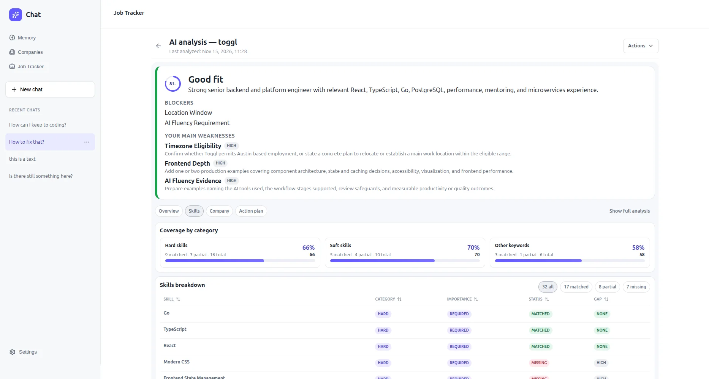
      </picture>
      <sub><b>Skills coverage</b>: matched, partial and missing requirements</sub>
    </td>
    <td width="50%">
      <picture>
        <source media="(prefers-color-scheme: dark)" srcset="docs/screenshots/dark-job-analysis-tab4.webp">
        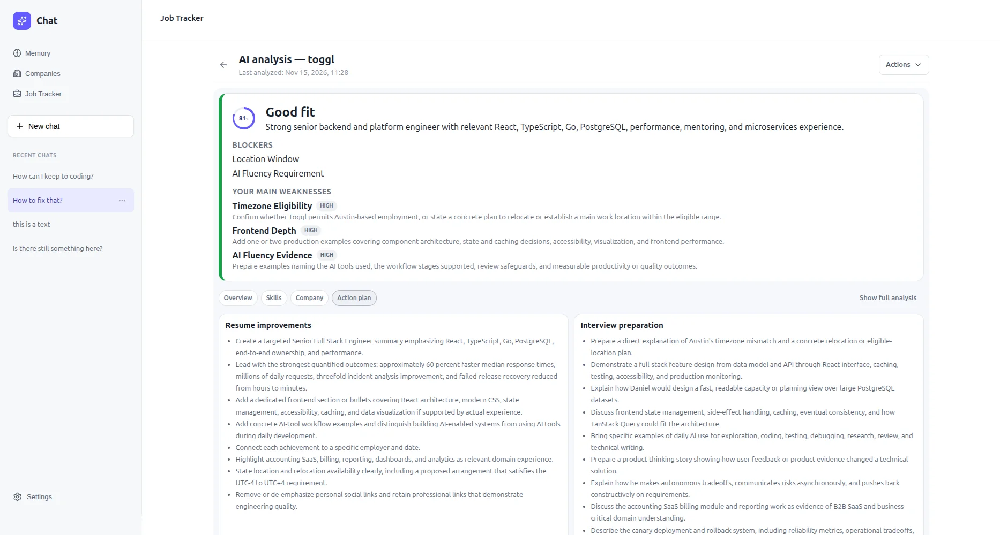
      </picture>
      <sub><b>Action plan</b>: resume fixes and interview preparation</sub>
    </td>
  </tr>
</table>

### A resume and cover letter for every job

<picture>
  <source media="(prefers-color-scheme: dark)" srcset="docs/screenshots/dark-create-customized-resume.webp">
  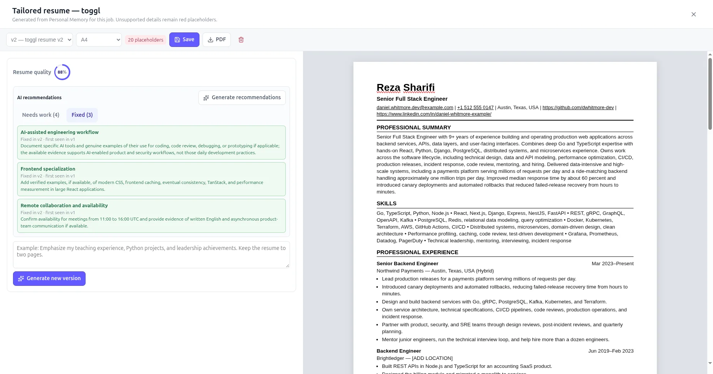
</picture>

<picture>
  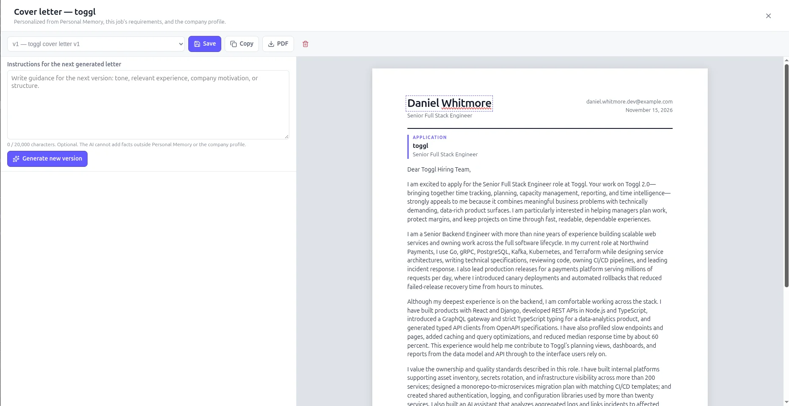
</picture>

### Your career, stored once

<picture>
  <source media="(prefers-color-scheme: dark)" srcset="docs/screenshots/dark-memory.webp">
  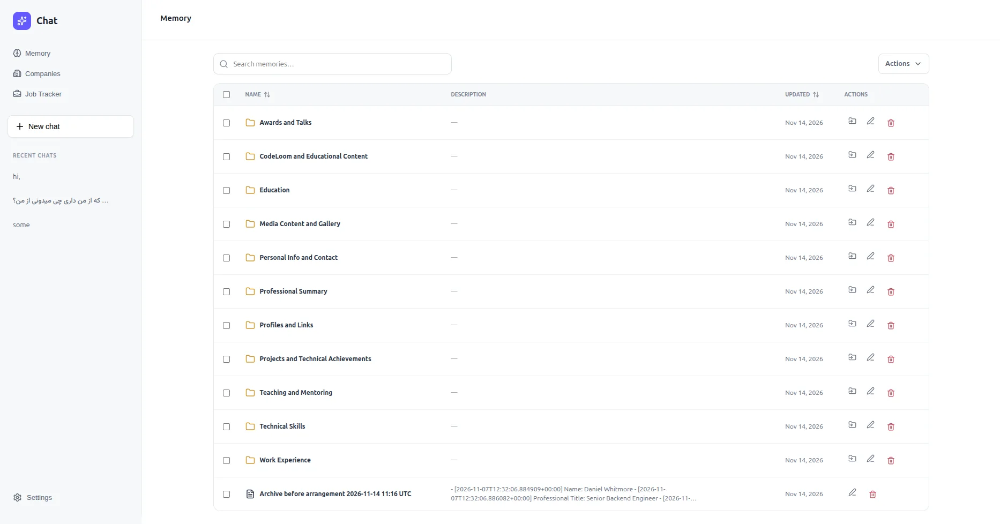
</picture>

<details>
<summary><b>Memory actions menu</b> (export .mem / .tex, import, arrange, clean)</summary>

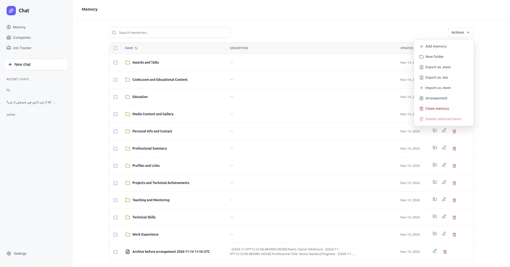

</details>

### Track every application

<table>
  <tr>
    <td width="50%">
      <picture>
        <source media="(prefers-color-scheme: dark)" srcset="docs/screenshots/dark-job-tracker.webp">
        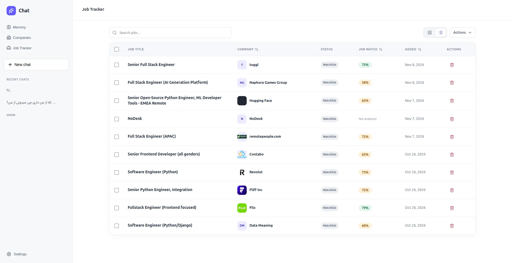
      </picture>
      <sub><b>Table view</b></sub>
    </td>
    <td width="50%">
      <picture>
        <source media="(prefers-color-scheme: dark)" srcset="docs/screenshots/dark-job-tracker-column-view.webp">
        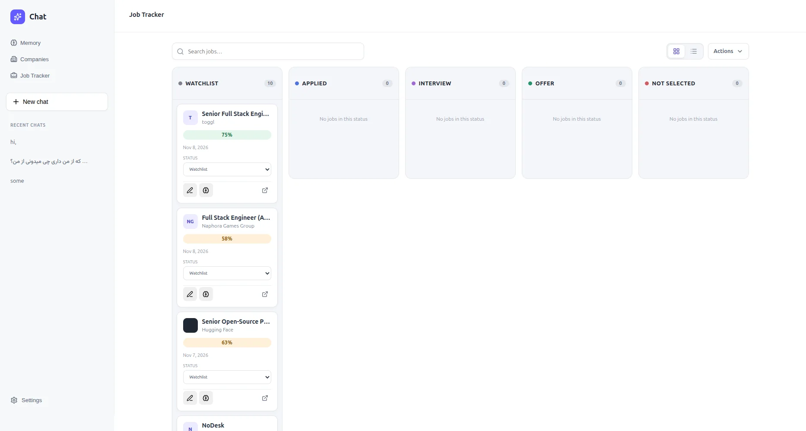
      </picture>
      <sub><b>Kanban board</b></sub>
    </td>
  </tr>
</table>

### Companies, chat and settings

<table>
  <tr>
    <td width="33%">
      <picture>
        <source media="(prefers-color-scheme: dark)" srcset="docs/screenshots/dark-companies.webp">
        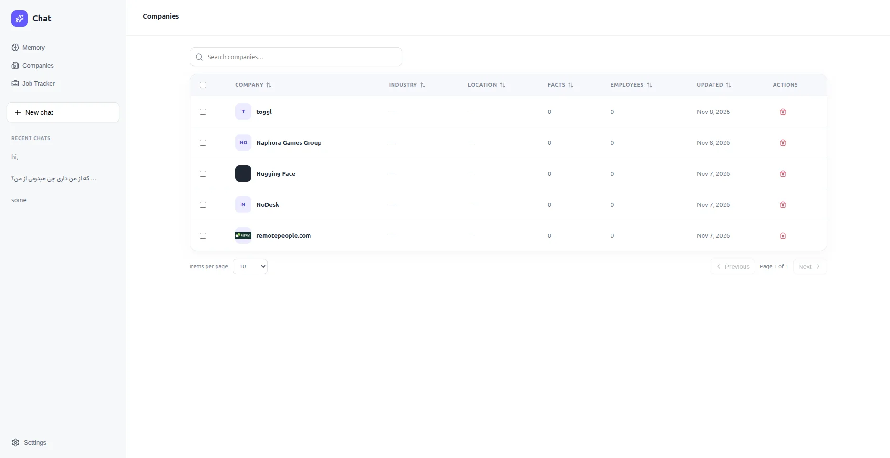
      </picture>
      <sub><b>Companies</b></sub>
    </td>
    <td width="33%">
      <picture>
        <source media="(prefers-color-scheme: dark)" srcset="docs/screenshots/dark-chat.webp">
        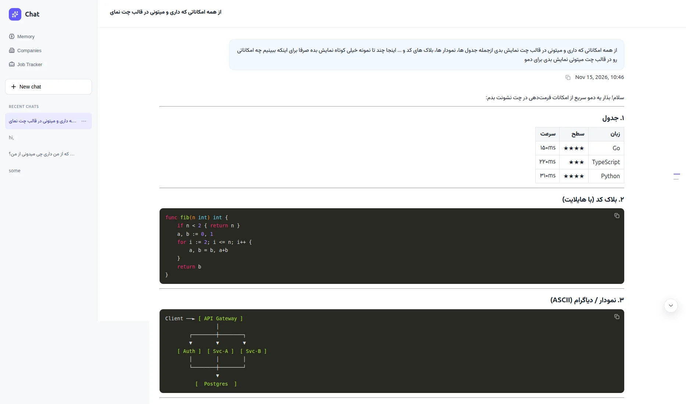
      </picture>
      <sub><b>Chat assistant</b></sub>
    </td>
    <td width="33%">
      <picture>
        <source media="(prefers-color-scheme: dark)" srcset="docs/screenshots/dark-settings-ai.webp">
        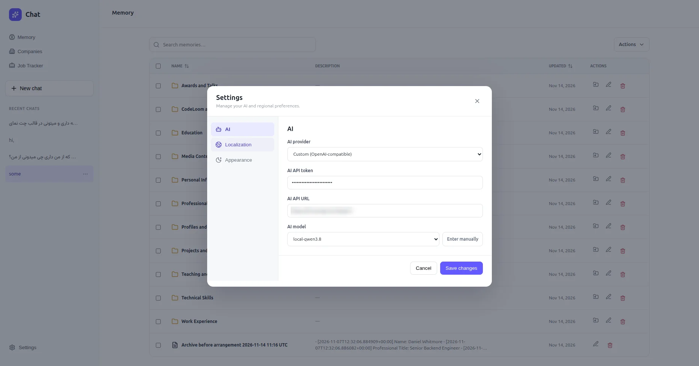
      </picture>
      <sub><b>Bring your own AI</b></sub>
    </td>
  </tr>
</table>

---

## How it works

```
Memory (your verified career facts)
      │
      ▼
Job posting ──► AI analysis ──► match, gaps, deal-breakers, action plan
                    │
                    ├──► Tailored resume (versions + PDF)
                    ├──► Tailored cover letter (versions + PDF)
                    └──► Job tracker (Watchlist → Applied → Interview → Offer)
```

1. **Configure AI** in *Settings → AI* (provider, token, base URL, model).
2. **Build your Memory** and master resume profile once.
3. **Add a job** and run the analysis.
4. **Generate a tailored resume and cover letter**, review them, export PDFs.
5. **Apply on the employer's site**, then update the status on the board.

> AI Job Analyzer does **not** submit applications for you and does not guarantee interviews. Generated documents are drafts: always review names, dates, employers, skills, metrics and links before sending.

---

## Quick start

**Requirements:** Python 3.10 or newer (a Django 5 requirement) and a current Node.js LTS with npm.

### 1. Backend

```bash
python3 -m venv .venv
source .venv/bin/activate
pip install -r requirements.txt

cp .env.example .env   # review the values; the AI provider is configured in the app (step 3)

python manage.py migrate
python manage.py runserver 8005
```

### 2. Frontend

```bash
cd frontend
npm install
npm run dev
```

Open **http://localhost:5173**. The Vite dev server proxies `/api` requests to Django on port 8005.

### 3. Connect an AI provider

Open **Settings → AI**, choose a provider, enter its API token and (optionally) a base URL, then pick a model from the live list. Local **Ollama** needs no token.

### Run the tests

```bash
# Backend
source .venv/bin/activate
python manage.py test chat

# Frontend
cd frontend
npm test
```

---

## Architecture

```
┌────────────────────────┐         ┌──────────────────────────────┐
│  React 19 (Vite)       │  /api   │  Django 5 (JSON API)         │
│  atoms / molecules /   │ ──────► │  chat/                       │
│  organisms / templates │  proxy  │  ├── views/       HTTP       │
│  hooks · utils · i18n  │         │  ├── services/    logic      │
└────────────────────────┘         │  ├── serializers.py · selectors.py
                                   │  └── models.py    domain     │
                                   └──────────────┬───────────────┘
                                                  │ server-side only
                                      ┌───────────▼────────────┐
                                      │  Provider adapters     │
                                      │  OpenAI-compatible ·   │
                                      │  Anthropic · Gemini    │
                                      └────────────────────────┘
```

- **Thin views, testable services.** Views handle parsing, validation and status codes. AI client (retry and TLS fallback), analysis parsing, resume and cover-letter generation, and PDF rendering live in `chat/services/`.
- **Provider-agnostic.** Adapters in `chat/services/providers.py` translate the app's OpenAI-style payloads to each provider's wire format and back.
- **Self-contained.** SQLite by default, no external database needed.
- Guidelines used when developing with AI assistants are documented in [AI-RULES.md](AI-RULES.md).

### Tech stack

| Layer | Tools |
| --- | --- |
| Backend | Django 5, django-cors-headers, pypdf / PyMuPDF / reportlab, Pillow, BeautifulSoup |
| Frontend | React 19, Vite, lucide-react, react-markdown, Vazirmatn font, node:test |
| AI | OpenAI-compatible APIs (OpenAI, OpenRouter, Groq, Mistral, DeepSeek, xAI, Ollama, custom) plus native Anthropic and Google Gemini |

### Project structure

```
├── server/          # Django project (settings, URLs, WSGI)
├── chat/            # the application
│   ├── views/       # thin HTTP layer, one module per domain
│   ├── services/    # AI client, analysis, resumes, cover letters, PDF
│   ├── serializers.py · selectors.py · models.py · tests.py
├── prompts/         # LLM prompt templates
└── frontend/
    └── src/
        ├── components/   # atoms → molecules → organisms → templates
        ├── hooks/ · i18n/ · utils/
```

---

## Privacy & security

- **Self-hosted.** Your Memory, resumes, analyses and applications are stored in your own database (SQLite by default). There is no hosted service behind this project.
- **AI requests are made by the Django backend** using the provider settings you configure in *Settings → AI*.
- Your prompts and career data are sent to the AI provider you choose. Use a local provider such as **Ollama** if you want everything to stay on your machine.
- **Built for personal use** on your own computer or a private network. If you ever expose it beyond that, put it behind authentication and HTTPS first.
- Keep your API tokens secret and never commit `.env` files.

## Roadmap

- [ ] Chat that can answer questions and compute statistics across all your past job analyses, to help you plan your next steps

## Contributing

Issues and pull requests are welcome. Please read [AI-RULES.md](AI-RULES.md) for the project's engineering standards and run both test suites before opening a PR.

## License

[MIT](LICENSE) © Mohammadreza Sharifi

## Author

Built by **Mohammadreza Sharifi** ([@kasaiee](https://github.com/kasaiee)).
Connect on [LinkedIn](https://www.linkedin.com/in/kasaiee/). If this project helps your job search, a ⭐ on GitHub means a lot.
